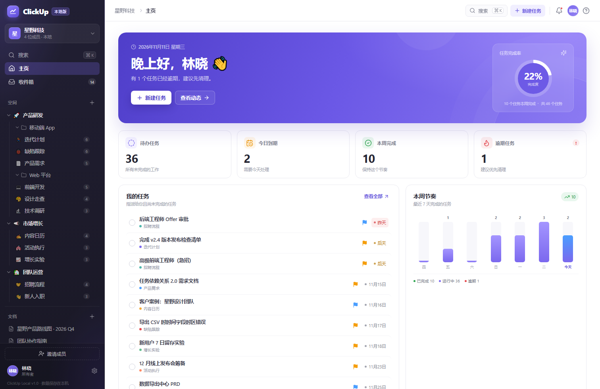
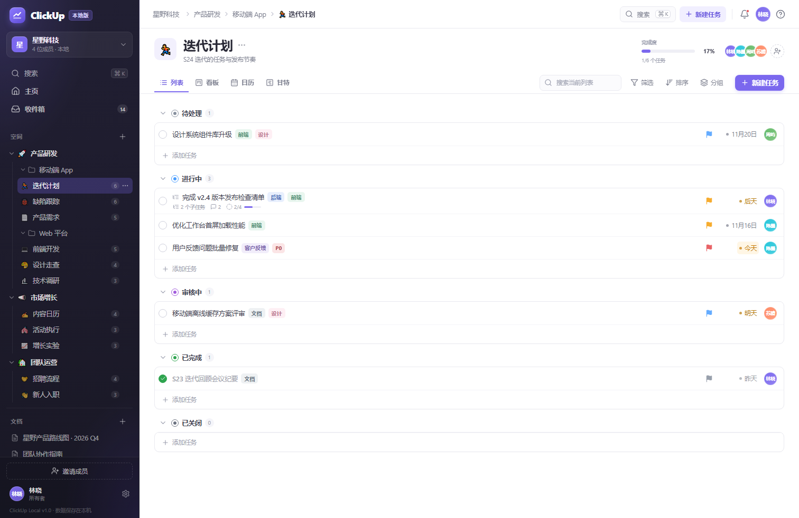
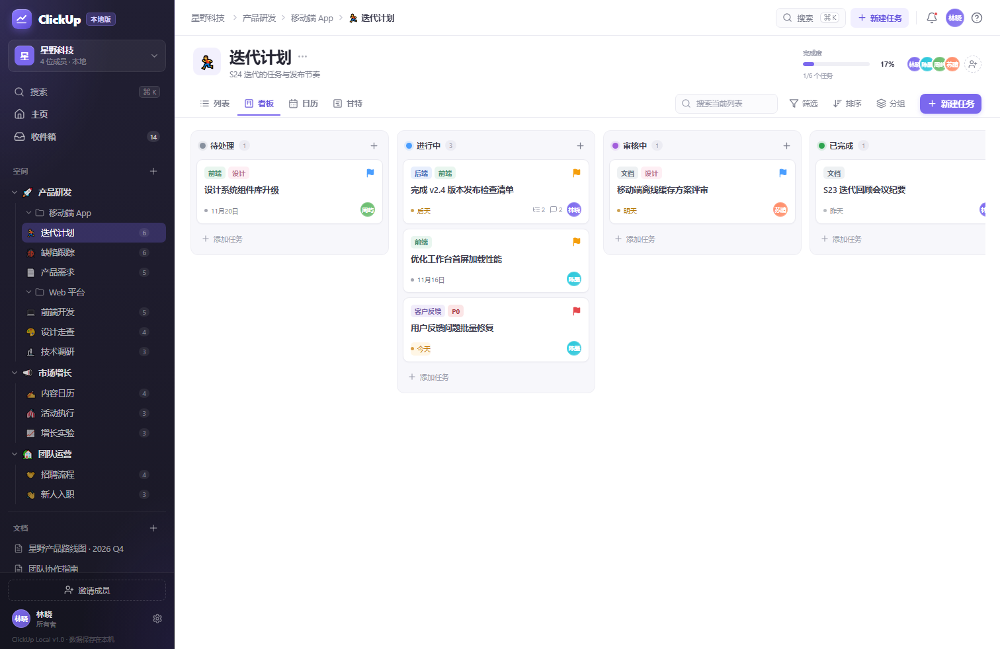
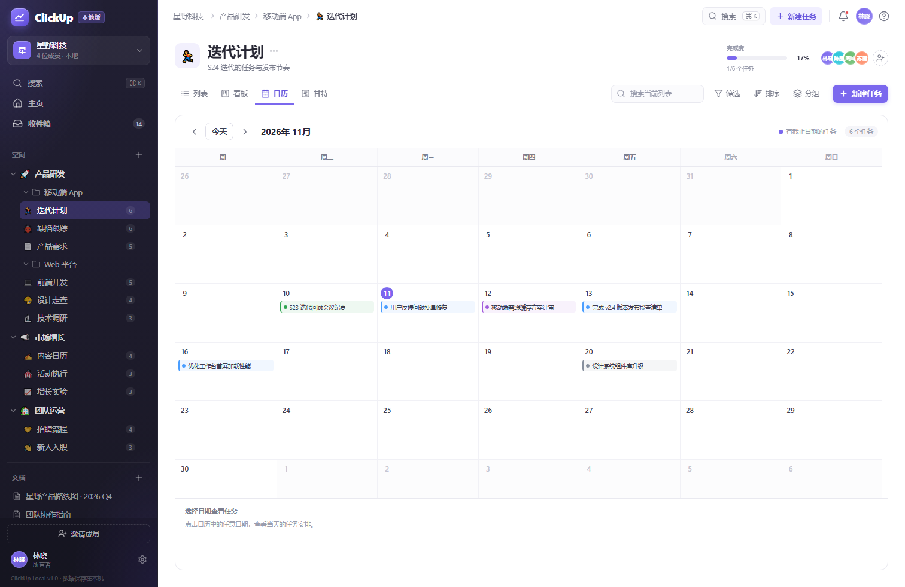
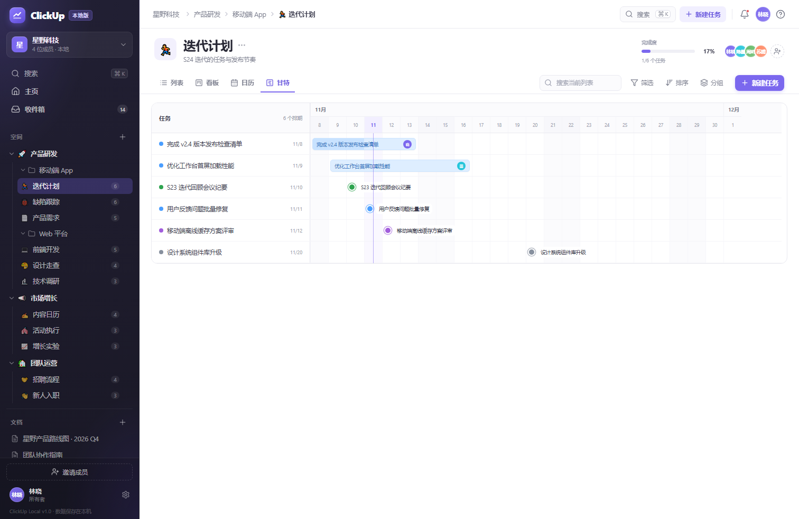
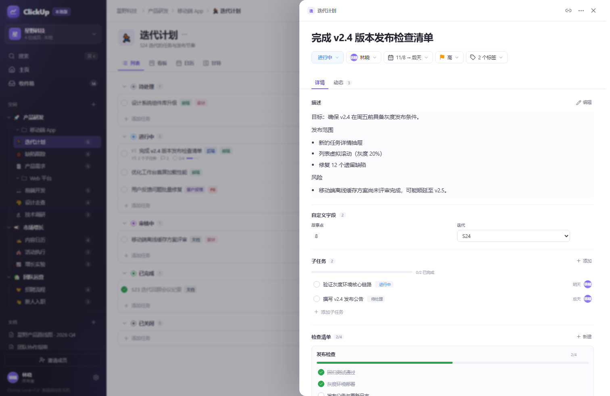
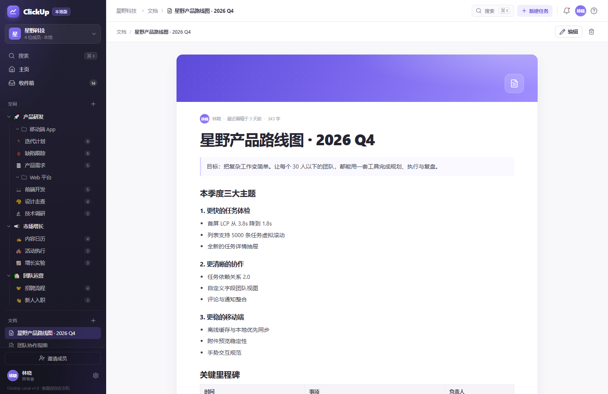
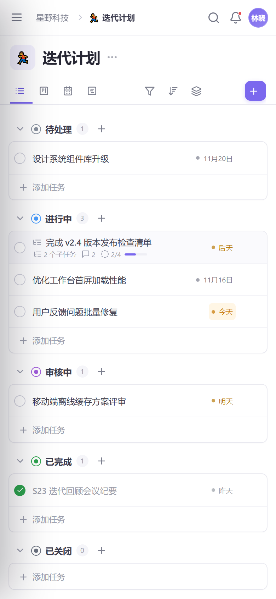

# ClickUp 本地版

> 一个可单机部署、在浏览器中使用的 ClickUp 风格团队工作空间。
> 不包含任何 AI 功能，数据全部保存在你自己的电脑上。



## 功能

| 模块 | 能力 |
| --- | --- |
| 工作空间 | 多工作空间、空间、文件夹、列表的层级组织；成员与角色管理；空间编辑、工作空间删除与重建 |
| 任务 | 状态、优先级、一位负责人 + 多位参与人、前置依赖与关系图、重复规则、开始/截止日期、标签、自定义字段、Markdown 描述；支持列表内直接改名和外部责任人 |
| 协作 | 子任务、**可编辑检查清单**、**进展**（完整日期时间、正序/倒序）、动态记录、附件上传（单文件最大 20MB） |
| 视图 | 概览、头脑风暴、列表、看板、日历、甘特图、复盘；列表可拖拽调整状态和顺序，任务与头脑风暴想法支持行内改名，看板可拖拽移动任务，甘特图显示依赖线和关键路径 |
| 主页日程 | 主页内置全部任务日历和时间轴，覆盖工作空间内的任务、子任务、已完成和未排期任务 |
| 会议 | 每个项目可记录多场会议；支持标题、时间、与会人、目标、内容、待解决问题和遗留问题；可导出 Markdown/Word；遗留问题可转任务；会议与任务可双向绑定 |
| 自动化 | 任务创建、完成或状态变更时自动修改状态、指派负责人、设置优先级或添加标签 |
| 识别色 | 空间和列表都支持有语义的识别色，应用到侧边栏、图标、列表头部和进度条 |
| 项目复用 | 将任意项目保存为模板；从模板创建项目，复用工作流、字段、任务、子任务、检查清单、标签、里程碑和项目阶段 |
| 项目概览 | 项目背景与目的、项目全景阶段、横向里程碑时间轴、任务完成度和近期任务 |
| 复盘 | 以单次复盘为管理点，把逾期与已完成任务放进同一条时间轴，填写复盘内容，支持多次复盘和历史快照 |
| 周报 | 按自然周选择范围，生成 A4 结构化项目周报；支持手动编辑、打印/另存为 PDF、下载可编辑 Word；包含概览、摘要、完成、进行中、风险、阶段与里程碑、下周计划和进展记录 |
| 项目组合 | 跨项目查看完成度、逾期任务、风险项目、当前阶段和下一个里程碑，支持按空间/健康度筛选 |
| 数据安全 | 每天自动备份 SQLite 数据库，保留最近 30 份；支持手动备份、下载和整库恢复，恢复前自动创建安全备份 |
| 效率 | 筛选、排序、分组、当前列表搜索、全局搜索（`Ctrl/⌘ + K`） |
| 工作台 | 主页统计、我的任务、完成趋势、工作负载、团队动态、收件箱未读 |
| 文档 | 工作空间级 Markdown 文档，自动保存、预览与编辑 |
| 设置 | 个人资料与密码、工作空间信息、成员邀请、外部责任人、标签、项目模板、工作流状态与自定义字段 |
| 部署 | Windows 安装包、一键启动、开机自启服务、Docker 部署、SQLite 数据文件备份 |

### 界面截图

| 列表视图 | 看板视图 |
| --- | --- |
|  |  |

| 日历视图 | 甘特图 |
| --- | --- |
|  |  |

| 任务详情 | 文档 |
| --- | --- |
|  |  |



## Windows 安装包（推荐）

不想处理 Node.js、命令行或端口环境时，可以直接使用 Windows 安装包：

**直接下载：** [ClickUp-Local-Setup-1.12.0.exe](https://github.com/pxxfrank/clickup-local/releases/download/v1.12.0/ClickUp-Local-Setup-1.12.0.exe)  
**发布页：** [GitHub Releases](https://github.com/pxxfrank/clickup-local/releases/latest)  
**文件名：** `ClickUp-Local-Setup-1.12.0.exe`（约 24 MB，已内置 Node.js 运行时）

安装包支持 Windows 10 / 11 x64，安装到当前用户目录，**不需要管理员权限**，也不需要预装 Node.js。

安装后会提供：

- 桌面与开始菜单快捷方式，点击自动启动后台服务并打开浏览器
- **后台服务模式**：可设置为登录 Windows 时自动在后台运行
- **调试控制台模式**：开始菜单打开后直接显示运行日志，方便定位启动失败
- 日志、数据目录、停止服务、卸载等独立入口
- 升级安装时自动停止旧服务，保留本地数据

安装版路径：

| 内容 | 路径 |
| --- | --- |
| 程序 | `%LOCALAPPDATA%\Programs\ClickUpLocal` |
| 数据 | `%LOCALAPPDATA%\ClickUpLocal\data` |
| 日志 | `%LOCALAPPDATA%\ClickUpLocal\logs` |

卸载默认保留数据与日志；确认不再使用时手动删除 `%LOCALAPPDATA%\ClickUpLocal`。

安装版使用独立的 `%LOCALAPPDATA%\ClickUpLocal\data` 目录。如果要从源码版迁移数据，请先停止两边的服务，再将源码目录中的 `data\clickup.db` 和 `data\uploads\` 复制到该目录。

> 安装版与源码版默认都监听 `23090` 端口，请勿同时启动。若之前运行过源码版，请先关闭其服务再启动安装版。

> 安装包未使用商业代码签名证书，Windows SmartScreen 可能显示“未知发布者”。
> 如需从源码重新构建安装包：
>
> ```powershell
> powershell -ExecutionPolicy Bypass -File packaging\windows\build.ps1
> ```
>
> 构建脚本会准备官方 Node.js 运行时、生产依赖和 NSIS 编译器，输出到 `release`。

## 快速开始（源码）

### 环境要求

- **Node.js 24 或更高版本**（项目使用 Node 内置的 `node:sqlite`，无需安装数据库）
- 现代浏览器（Chrome / Edge / Firefox / Safari）

### Windows：双击启动

双击项目根目录的 **`start-clickup.cmd`**。

脚本会自动检查依赖和前端构建结果，启动本地服务并打开：

```
http://127.0.0.1:23090
```

### 命令行启动

```bash
npm install
npm run build
npm start -- --open
```

开发模式（前端热更新 + API 代理）：

```bash
npm run dev
# 前端：http://localhost:5173
# API： http://127.0.0.1:23090
```

### 演示账号

首次启动会自动写入一套完整的演示数据（星野科技团队）：

```
邮箱：demo@clickup.local
密码：demo1234
```

登录页上的「使用演示工作空间」按钮可以一键进入。演示数据只会在数据库为空时写入一次。

### 把列表当项目用

- 打开项目默认进入「概览」，视图顺序为：**概览、头脑风暴、列表、看板、日历、甘特、复盘**。
- **头脑风暴**：连续记录零散想法，最后统一送入「待处理」。
- **概览**：填写项目背景与目的、设置里程碑，并通过横向时间轴查看关键节点。
- **项目全景**：在项目背景与目的下方定义阶段（名称、起止日期、颜色）。阶段色块与里程碑共用同一条日期刻度，色块起止、里程碑节点和日期严格对齐；里程碑会按日期自动归入阶段并显示对应颜色。
- **复盘**：每次复盘会快照当前逾期和已完成任务，形成独立时间轴；支持多次复盘、填写和修改复盘内容，历史会话互不影响。
- 任务支持 **一位负责人 + 多位参与人**；参与人可以多选，并会显示在列表和看板的任务卡片上。
- **列表拖拽**：在「按状态分组 + 手动排序」且没有筛选条件时，拖动任务行首的手柄可以调整状态和组内顺序。
- **识别色**：空间和列表的颜色不再是装饰——空间会用于图标和侧边栏标识，列表会用于图标、选中行、列表头部和完成度进度条；颜色选择器会显示“产品/市场/交付”等语义提示。
- **进展**：任务详情中的“评论”已改为“进展”，记录显示完整的 `YYYY-MM-DD HH:mm` 日期时间，并可在“最新在前/最早在前”之间切换。
- **检查清单编辑**：清单名称和检查项名称都可以点击编辑，Enter 保存，Esc 取消。
- **项目周报**：在列表页点击「周报」，选择自然周后预览 A4 周报；可直接在预览中编辑文字，再打印/另存为 PDF，或下载为可编辑 Word 文档。
- **项目组合**：侧边栏的「项目组合」汇总当前工作空间所有项目的完成度、逾期、风险、阶段和里程碑。
- **备份恢复**：设置 → 工作空间 → 自动与手动备份；每天自动备份并保留最近 30 份，可下载或恢复整库。恢复前会自动创建安全备份。
- **任务依赖**：任务详情在描述和子任务之间直接展示依赖拓扑图，不需要额外点击查看；右上角「编辑依赖」打开编辑面板。左侧为上游前置任务，右侧为下游后续任务，箭头从前置指向后续。可勾选多个前置任务；系统禁止依赖自己，并拦截任何循环依赖；甘特图同步绘制依赖箭头并高亮关键路径。
- **主页日程**：主页「全部任务日程」可在日历和时间轴之间切换；日历按截止日期排布，时间轴按日期分组，子任务、已完成任务和未排期任务也会呈现。
- **会议记录**：项目视图 → 会议。会议详情使用与任务详情一致的右侧抽屉和分区样式；可编辑标题、时间（15 分钟步进）、与会人、目标、需要讲的内容、需要解决的问题和遗留问题；支持导出 Markdown / Word。
- **会议与任务双向绑定**：会议「需要解决的问题」旁可以绑定多个现有任务并以列表管理；任务详情 → 关联会议可以绑定当前项目的会议。遗留问题以列表行直接编辑，可一键「转换成任务」或删除。
- **Markdown 所见即所得**：会议内容、任务描述、新建任务描述、项目文档均采用单栏编辑，不再分左右两栏；输入内容直接呈现为标题、列表、粗体等格式，保存时仍序列化为 Markdown。会议内容和任务描述可通过「引用任务」插入蓝色任务标记。
- **自动化**：列表设置 → 自动化，可配置“任务创建/完成/状态变更”时自动改状态、指派、设置优先级或添加标签。
- **重复任务**：任务详情 → 重复，可设置每天/每周/每月；任务完成后自动生成下一次任务。
- **行内编辑**：列表任务和头脑风暴想法都支持点击行内铅笔直接改名，Enter 保存、Esc 取消，不必打开详情抽屉。
- 列表右上角 **⋯ → 另存为项目模板** 可以把当前项目完整保存为模板。
- 在空间或文件夹的 **⋯ → 从模板创建项目** 中选择模板，即可复用任务、子任务、工作流、自定义字段、标签和里程碑。
- 在任务详情的负责人菜单底部输入姓名，可以直接创建并指派**外部责任人**；TA 不需要加入工作空间，之后会一直保留在指派列表中。
- 工作空间设置中可以管理外部责任人、项目模板和成员。

## 安装为开机自启服务（源码方式）

如果使用源码版本，并希望 ClickUp 在登录 Windows 后自动在后台运行：

```powershell
powershell -ExecutionPolicy Bypass -File scripts\install-service.ps1
```

安装脚本会：

- 注册名为 `ClickUpLocal` 的登录自启任务（后台隐藏运行）
- 在桌面创建「ClickUp 本地版」快捷方式
- 立即启动服务并打开浏览器

指定其他端口：

```powershell
powershell -ExecutionPolicy Bypass -File scripts\install-service.ps1 -Port 23100
```

卸载：

```powershell
powershell -ExecutionPolicy Bypass -File scripts\uninstall-service.ps1
# 同时删除本地数据库和附件（不可撤销）：
powershell -ExecutionPolicy Bypass -File scripts\uninstall-service.ps1 -RemoveData
```

安装脚本不会删除项目文件，数据默认保留在 `data` 目录。

## 配置

| 环境变量 | 默认值 | 说明 |
| --- | --- | --- |
| `PORT` | `23090` | HTTP 端口 |
| `HOST` | `127.0.0.1` | 监听地址；设为 `0.0.0.0` 可供局域网访问 |
| `CLICKUP_DATA_DIR` | `./data` | 数据库与附件的存放目录 |

也可以使用命令行参数指定端口：

```bash
npm start -- --port 23100
```

局域网访问（同一 Wi-Fi / 内网）：

```powershell
$env:HOST = "0.0.0.0"
npm start
# 其他设备访问 http://<你的电脑IP>:23090
```

> 如果开启了 Windows 防火墙，需要允许 Node.js 或该端口的入站连接。
> 局域网部署建议配合反向代理与 HTTPS，并修改演示账号密码。

## 数据与备份

- 数据库：`data/clickup.db`（SQLite，WAL 模式）
- 附件：`data/uploads/`
- 备份：进入 **设置 → 工作空间 → 下载数据库备份**，或直接复制整个 `data` 目录
- 恢复：停止服务后，用备份文件替换 `data/clickup.db`（恢复时建议同时移除 `clickup.db-wal` / `clickup.db-shm`）

应用没有云端依赖，不会向外部服务器上传数据。

## Docker 部署

适合 NAS、Linux 小主机或习惯容器化的场景：

```bash
docker compose up -d --build
# 打开 http://127.0.0.1:23090
```

或者：

```bash
docker build -t clickup-local .
docker run -d --name clickup-local \
  -p 23090:23090 \
  -v "$(pwd)/data:/app/data" \
  clickup-local
```

容器内默认监听 `0.0.0.0:23090`，数据挂载到宿主机的 `data` 目录。

## 技术实现

- **前端**：React 19 + Vite，CSS 设计系统，`lucide-react` 图标，`marked` + `DOMPurify` Markdown 渲染
- **后端**：Node.js + Express，REST API
- **数据库**：Node 内置 `node:sqlite`（SQLite）
- **认证**：`scrypt` 密码哈希 + HttpOnly 会话 Cookie
- **部署**：单进程服务，同时托管 API 与静态前端

### 目录结构

```
server/
  index.js       服务入口、静态文件托管
  api.js         全部 REST API
  auth.js        登录、注册、会话
  db.js          SQLite 表结构
  seed.js        演示数据
  security.js    密码与令牌工具
client/
  src/
    components/  页面、视图、弹窗与任务详情
    lib/         API、日期、Markdown、路由工具
    styles*.css  设计系统与响应式样式
scripts/
  install-service.ps1 / uninstall-service.ps1
  run-hidden.vbs
start-clickup.cmd
Dockerfile / docker-compose.yml
```

### 主要 API

| 方法 | 路径 | 说明 |
| --- | --- | --- |
| `POST` | `/api/auth/login` | 登录 |
| `POST` | `/api/auth/register` | 注册并创建个人工作空间 |
| `GET` | `/api/bootstrap` | 工作空间树、成员、标签、未读数 |
| `GET` | `/api/lists/:id` | 列表、状态、字段与任务 |
| `POST/PATCH/DELETE` | `/api/tasks`、`/api/tasks/:id` | 任务 CRUD |
| `POST` | `/api/tasks/:id/move` | 列表/看板拖拽调整状态与顺序 |
| `POST` | `/api/tasks/:id/comments` | 记录进展（兼容旧路径名） |
| `GET` | `/api/lists/:id/weekly-report` | A4 项目周报 HTML（可选 `start`/`end`） |
| `GET` | `/api/portfolio` | 当前工作空间跨项目组合数据 |
| `GET/POST` | `/api/backups` | 备份列表 / 创建手动备份 |
| `POST` | `/api/backups/:name/restore` | 恢复数据库备份 |
| `PATCH` | `/api/tasks/:id` | 任务更新、依赖和重复规则 |
| `GET/POST` | `/api/lists/:id/automations` | 自动化规则列表 / 创建 |
| `PATCH/DELETE` | `/api/automations/:id` | 自动化规则更新 / 删除 |
| `GET/POST` | `/api/lists/:id/meetings` | 会议列表 / 创建会议 |
| `GET/PATCH/DELETE` | `/api/meetings/:id` | 会议详情 / 更新 / 删除 |
| `POST` | `/api/meeting-issues/:id/create-task` | 将会议遗留问题转为任务 |
| `GET` | `/api/search?q=` | 全局搜索 |
| `GET` | `/api/home` | 主页统计 |
| `GET/POST` | `/api/inbox`、`/api/inbox/read` | 动态与已读状态 |
| `GET/POST/PATCH` | `/api/docs`、`/api/docs/:id` | 文档 |
| `GET` | `/api/backup` | 下载数据库备份 |

完整接口可在 `server/api.js` 中查看。

## 快捷键

| 快捷键 | 功能 |
| --- | --- |
| `Ctrl/⌘ + K` | 打开全局搜索 |
| `N` | 新建任务（不在输入框中时） |
| `Esc` | 关闭搜索、弹窗或任务详情 |
| `Ctrl/⌘ + Enter` | 在新建任务/进展框中提交 |

## 说明与限制

- 空间可通过侧栏的「⋯ → 编辑空间」修改名称、图标和颜色；所有者可在「设置 → 工作空间」中永久删除工作空间。
- 删除最后一个工作空间后，会进入「创建工作空间」引导页，不会丢失当前账号。
- 这是一个以本地优先为目标的 ClickUp 风格实现，并非 ClickUp 官方产品，也不追求像素级复刻。
- 不包含 AI、第三方集成、邮件通知、实时多人推送（WebSocket）等功能。
- 团队协作以同一台机器上的多个账号进行；要跨设备使用，请通过局域网地址访问。
- 附件上限 20MB，存储在本地 `data/uploads`。
- 使用 Node 24 启动时控制台可能出现 `node:sqlite` 的 ExperimentalWarning，不影响功能。
- 首次登录后建议在「个人资料」中修改演示账号密码，并定期下载数据备份。

## License

本项目仅用于学习与自托管实践。ClickUp 是 ClickUp Software 的商标；本项目与 ClickUp 官方无关。
